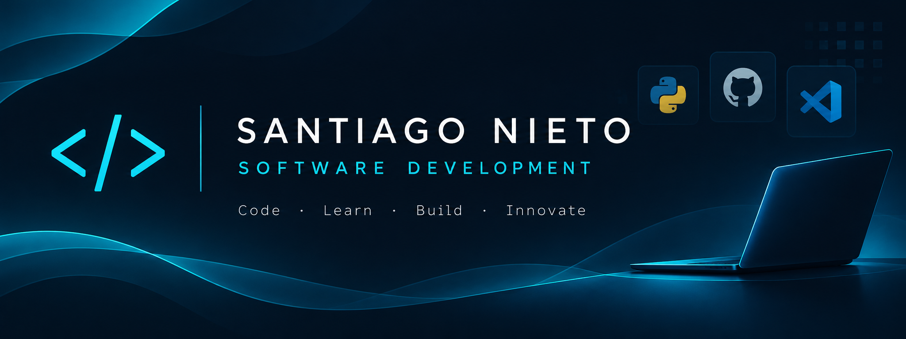

  

  
  
  
  

 🎓 Perfil académico

Estudiante de Ingeniería en Informática en la **Universidad de Buenos Aires (UBA)**.

Certificado en Iniciación a la Programación con Python por **Talento Tech**.

## 👨‍💻 Sobre mí

Me interesa la programación como herramienta para transformar ideas en proyectos concretos. Disfruto aprender nuevas tecnologías, resolver problemas y desarrollar soluciones utilizando la creatividad y el pensamiento lógico.

Actualmente estoy enfocado en ampliar mis conocimientos y construir proyectos personales que me permitan aplicar lo aprendido y adquirir experiencia práctica.

## 🎯 Áreas de interés

- Desarrollo de software y aplicaciones.
- Desarrollo web.
- Desarrollo de videojuegos.
- Inteligencia artificial.
- Programación de sistemas.

## 🎓 Formación y certificaciones

- **Ingeniería en Informática** — Universidad de Buenos Aires (UBA).
- **Iniciación a la Programación con Python** — Talento Tech (80 horas).

## 🚀 Proyectos

Mi objetivo es desarrollar proyectos personales que reflejen mi aprendizaje y evolución como programador.

Estoy especialmente interesado en crear aplicaciones, sitios web y videojuegos.

## 📫 Contacto

- **GitHub:** [@Martinnieto-hub](https://github.com/Martinnieto-hub)
- **LinkedIn:** [Santiago Nieto](https://www.linkedin.com/in/santiago-nieto-846b27395/)
